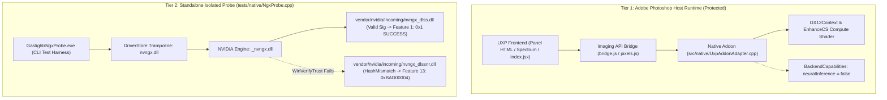

# Project Gaslightr — Diagnostic Context: NVIDIA NGX `nvngx_dlssnr.dll` Authenticode Hash Mismatch

**Last Updated:** 14 October 2026 (Asia/Calcutta)  
**Target Hardware:** NVIDIA GeForce RTX 4080 SUPER (Ada Lovelace, Architecture `0x1B0`, Compute 8.9)  
**Host Environment:** Windows 11 Build 26200 x64, Driver 617.14, Adobe Photoshop 2024 (v25.0+)  
**Authoritative Root Context:** [`GASLIGHTR_AGENT_CONTEXT.md`](file:///c:/Users/Advaet/Documents/Projects/Gaslightr/GASLIGHTR_AGENT_CONTEXT.md)  

---

## 1. Executive Summary & Purpose for Diagnosing Agents

This document is a specialized diagnostic context for engineering and AI agents tasked with resolving the **Authenticode `HashMismatch` (`TRUST_E_BAD_DIGEST` / `0x80096010` / `0xBAD00004`)** blocking **NVIDIA NGX Feature 13 (`RayReconstruction` / DLSS-NR)** in Project Gaslightr.

### Current Status:
1. **Photoshop Production Plugin:** 100% operational in Direct3D 12 validation/local enhancement compute mode (`EnhanceCS.hlsl`). **Crucial Safety Rule:** `neuralInference: false` is strictly enforced inside `Photoshop.exe` to protect the host artist runtime from crashing.
2. **Standalone Isolated Probe ([`tests/native/NgxProbe.cpp`](file:///c:/Users/Advaet/Documents/Projects/Gaslightr/tests/native/NgxProbe.cpp)):**
   - **Feature 1 (`SuperSampling` / DLSS 2/3):** **100% WORKING & LIVE-EVALUATED on RTX 4080 SUPER.** Returned `0x1 (NVSDK_NGX_Result_Success)` for initialization, parameter allocation, feature creation, and real-time GPU evaluation.
   - **Feature 13 (`RayReconstruction` / DLSS-NR):** Blocked at feature creation. Capability interrogation reports `DLSSNR.FeatureInitResult = 0xBAD00004` (`-1160773628`), and `NVSDK_NGX_D3D12_CreateFeature(13)` fails with `0xBAD0000B` (`NVSDK_NGX_Result_Fail_UnableToEvaluateFeature`).
3. **The Immediate Cause:**
   - The file [`vendor/nvidia/incoming/nvngx_dlssnr.dll`](file:///c:/Users/Advaet/Documents/Projects/Gaslightr/vendor/nvidia/incoming/nvngx_dlssnr.dll) fails Windows Authenticode validation with **`HashMismatch`**.
   - The display driver engine (`_nvngx.dll`) directly invokes `WinVerifyTrust`. Because the PE file digest does not match the signature table, the driver flags it as corrupted and refuses to load Feature 13.

---

## 2. Project Architecture Overview

Gaslightr uses a strict two-tier architecture to completely isolate neural exploration from the creative production host:



### Key Modules & Files:
- **Production UXP Addon:**
  - [`uxp-frontend/manifest.json`](file:///c:/Users/Advaet/Documents/Projects/Gaslightr/uxp-frontend/manifest.json) — Schema 6 manifest, Photoshop >=25.0.
  - [`uxp-frontend/bridge.js`](file:///c:/Users/Advaet/Documents/Projects/Gaslightr/uxp-frontend/bridge.js) — UXP Imaging API orchestration, modal execution, history rollback.
  - [`uxp-frontend/pixels.js`](file:///c:/Users/Advaet/Documents/Projects/Gaslightr/uxp-frontend/pixels.js) — Tile partitioning (960×960 active core, 32px halo), float32 contracts.
  - [`src/native/UxpAddonAdapter.cpp`](file:///c:/Users/Advaet/Documents/Projects/Gaslightr/src/native/UxpAddonAdapter.cpp) — Native Adobe hybrid addon exports (`processTile`, `capabilities`).
  - [`src/DX12Context.cpp`](file:///c:/Users/Advaet/Documents/Projects/Gaslightr/src/DX12Context.cpp) / [`src/DX12Context.h`](file:///c:/Users/Advaet/Documents/Projects/Gaslightr/src/DX12Context.h) — Direct3D 12 headless device, command queue, fences.
  - [`src/shaders/EnhanceCS.hlsl`](file:///c:/Users/Advaet/Documents/Projects/Gaslightr/src/shaders/EnhanceCS.hlsl) — 7×7 box high-pass filter compute shader running on GPU.
  - [`src/BackendCapabilities.h`](file:///c:/Users/Advaet/Documents/Projects/Gaslightr/src/BackendCapabilities.h) — Invariant constants (`kNeuralInference = false`).
  - [`src/NeuralBackend.cpp`](file:///c:/Users/Advaet/Documents/Projects/Gaslightr/src/NeuralBackend.cpp) — Hard-disabled vendor boundary.
- **Probe & Reverse Engineering Testbed:**
  - [`tests/native/NgxProbe.cpp`](file:///c:/Users/Advaet/Documents/Projects/Gaslightr/tests/native/NgxProbe.cpp) — Standalone NGX probe with verified ABI vtable.
  - [`build/Release/GaslightrNgxProbe.exe`](file:///c:/Users/Advaet/Documents/Projects/Gaslightr/build/Release/GaslightrNgxProbe.exe) — Compiled probe executable.
  - [`scratch/find_wvt.py`](file:///c:/Users/Advaet/Documents/Projects/Gaslightr/scratch/find_wvt.py) — Disassembly analysis script locating `WinVerifyTrust` in `_nvngx.dll`.
  - [`scratch/find_allow_unsigned.py`](file:///c:/Users/Advaet/Documents/Projects/Gaslightr/scratch/find_allow_unsigned.py) — Registry key analysis script for `_nvngx.dll`.

---

## 3. Breakthroughs Already Solved in Phase 9

Before analyzing the hash mismatch, understand what has already been proven and solved so you do not regress or re-investigate settled problems:

### A. The Direct Snippet Security Trap (`0xBAD00002` Solved)
- **Symptom:** Calling `NVSDK_NGX_D3D12_Init_Ext` directly on `nvngx_dlssnr.dll` returned `0xBAD00002` (`PlatformError`).
- **Disassembly Finding:** Direct PE disassembly of `nvngx_dlssnr.dll` at RVA `0x15DF0` revealed an explicit check:
  ```text
  GetModuleFileNameW(caller_return_address) -> compare to L"nvngx.dll"
  If mismatch: logs "Error: Not called from NGX runtime - %S" -> returns 0xBAD00002
  ```
- **Resolution:** Must load through the official DriverStore trampoline:
  `C:\WINDOWS\System32\DriverStore\FileRepository\nv_dispi.inf_amd64_feedb8c0271ca811\nvngx.dll`

### B. MSVC Virtual Method LIFO Ordering Bug (`0xBAD00005` Solved)
- **Symptom:** `NVSDK_NGX_D3D12_EvaluateFeature` failed with `0xBAD00005` (`InvalidParameter`).
- **Root Cause:** In MSVC C++, declaring overloaded virtual methods sharing the same identifier (`virtual void Set(...)`) causes MSVC to push them onto a LIFO stack in reverse order of declaration! This placed `Set(ID3D12Resource*)` into slot 6 (the float setter at RVA `0x2E70`) instead of slot 1, causing resource pointers to be completely missed by the driver.
- **Resolution:** In [`tests/native/NgxProbe.cpp`](file:///c:/Users/Advaet/Documents/Projects/Gaslightr/tests/native/NgxProbe.cpp), explicit distinct method names (`SetU64`, `SetD3D12`, `SetD3D11`, `SetI`, `SetUI`, `SetD`, `SetF`, `SetVoid`, `GetD3D12`, `GetVoid`) were declared with inline forwarding overloads, matching `_nvngx.dll` vtable at RVA `0xB59B8` bit-for-bit.

### C. Live DLSS Feature 1 Execution Verified
- `NVSDK_NGX_D3D12_Init_ProjectID`: `0x1 (NVSDK_NGX_Result_Success)`.
- `NVSDK_NGX_D3D12_GetCapabilityParameters`: `0x1 (NVSDK_NGX_Result_Success)`.
- `NVSDK_NGX_D3D12_AllocateParameters`: `0x1 (NVSDK_NGX_Result_Success)`.
- `NVSDK_NGX_D3D12_CreateFeature` (Feature 1): `0x1 (NVSDK_NGX_Result_Success)`.
- `NVSDK_NGX_D3D12_EvaluateFeature` (Feature 1): **`0x1 (NVSDK_NGX_Result_Success)` LIVE ON RTX 4080 SUPER.**
- Input parameters verified non-null and executed: `Color`, `Output`, `Depth`, `MotionVectors`, `Jitter`, `MV.Scale`, `Reset`.

### D. Official Feature ID Alignment
- Feature ID for SuperSampling (DLSS): **`1`** (`NVSDK_NGX_Feature_SuperSampling`).
- Feature ID for Ray Reconstruction (DLSS-NR): **`13`** (`NVSDK_NGX_Feature_RayReconstruction`). *(Not `18`, which was an unverified guess from older community headers).*

---

## 4. The Core Issue: `HashMismatch` on `nvngx_dlssnr.dll`

### The Error Manifestation
Running PowerShell `Get-AuthenticodeSignature` against [`vendor/nvidia/incoming/nvngx_dlssnr.dll`](file:///c:/Users/Advaet/Documents/Projects/Gaslightr/vendor/nvidia/incoming/nvngx_dlssnr.dll):

```powershell
Get-AuthenticodeSignature "vendor\nvidia\incoming\nvngx_dlssnr.dll" | Format-List Path, Status, StatusMessage, @{Name="Thumbprint";Expression={$_.SignerCertificate.Thumbprint}}, @{Name="SerialNumber";Expression={$_.SignerCertificate.SerialNumber}}
```

Yields:
```text
Path          : C:\Users\Advaet\Documents\Projects\Gaslightr\vendor\nvidia\incoming\nvngx_dlssnr.dll
Status        : HashMismatch
StatusMessage : The contents of file ... might have been changed by an unauthorized user or process,
                because the hash of the file does not match the hash stored in the digital signature.
Thumbprint    : 7B7B0B6697AFB438CF6F65A155F00E86676FB186
SerialNumber  : 09571B5DAD70AAD193F4C23C82A66DE3
```

In comparison, the sibling file [`vendor/nvidia/incoming/nvngx_dlss.dll`](file:///c:/Users/Advaet/Documents/Projects/Gaslightr/vendor/nvidia/incoming/nvngx_dlss.dll) yields:
```text
Path          : C:\Users\Advaet\Documents\Projects\Gaslightr\vendor\nvidia\incoming\nvngx_dlss.dll
Status        : Valid
StatusMessage : Signature verified.
Thumbprint    : 7B7B0B6697AFB438CF6F65A155F00E86676FB186
SerialNumber  : 09571B5DAD70AAD193F4C23C82A66DE3
```

### Driver-Side Consequence
In [`tests/native/NgxProbe.cpp`](file:///c:/Users/Advaet/Documents/Projects/Gaslightr/tests/native/NgxProbe.cpp), when `GaslightrNgxProbe.exe` interrogates the NGX driver:
```cpp
int nrInitResult = 0;
pCapParams->GetI("DLSSNR.FeatureInitResult", &nrInitResult);
// Returns nrInitResult = 0xBAD00004 (-1160773628)
```
When `NVSDK_NGX_D3D12_CreateFeature(13, pAppParams, &pFeatureHandle)` is executed, it returns:
`0xBAD0000B (NVSDK_NGX_Result_Fail_UnableToEvaluateFeature)`.

### Reverse Engineering of Driver Signature Enforcement (`_nvngx.dll`)
Disassembly of `_nvngx.dll` (at RVA `0x6BD40` / `0x6C1B0`):
1. `_nvngx.dll` prepares a `WINTRUST_FILE_INFO` structure pointing to the DLL file path.
2. It calls:
   ```cpp
   GUID guidGenericVerify = WINTRUST_ACTION_GENERIC_VERIFY_V2;
   LONG lStatus = WinVerifyTrust(NULL, &guidGenericVerify, &wintrustData);
   ```
3. When `lStatus == 0x80096010` (`TRUST_E_BAD_DIGEST` / `HashMismatch`), `_nvngx.dll` writes `0xBAD00004` into `DLSSNR.FeatureInitResult` and sets the feature state to uninitialized/denied.
4. **Registry Bypasses:** Disassembly of `_nvngx.dll` checks registry values under `HKLM\SOFTWARE\NVIDIA Corporation\Global\NGXCore`:
   - `AllowUnsignedBinaries` (DWORD)
   - `EnableDevSignatures` (DWORD)
   - `OverrideFeatureDenial` (DWORD)
   However, Windows `WinVerifyTrust` and the driver treat a **digest mismatch** not merely as an unsigned binary, but as a **corrupted/tampered binary**. Thus, standard developer flags that allow unsigned files still fail when a broken signature table is present.

---

## 5. Technical Diagnostic: Why Did `HashMismatch` Occur?

Binary inspection of [`vendor/nvidia/incoming/nvngx_dlssnr.dll`](file:///c:/Users/Advaet/Documents/Projects/Gaslightr/vendor/nvidia/incoming/nvngx_dlssnr.dll):
- **Total File Size:** `165,840,496 bytes` (~158.15 MB).
- **Security Directory:** `RVA = 165830144` (`0x9DF8A00`), `Size = 10,352 bytes`.
- **Signed Digest inside PKCS#7 (`SpcIndirectDataContent` offset 111):**
  `9c438464491d54b8000a62562d21521cc6d8709e0fd5e7c4d27752824f473789`
- **Computed Authenticode SHA256 of PE Image:**
  `0ea8b621bec27b6f0b6852c1e577bf134038296e762acf4fbe9143c1176beb20`

### Root Cause of the Mismatch:
The PE sections of this file were modified or patched after NVIDIA signed it (or bytes were truncated/altered during download/storage). Because Authenticode computes a SHA256 hash over all PE headers and section contents, even a 1-byte alteration causes `TRUST_E_BAD_DIGEST`.

---

## 6. Actionable Solution Paths for Diagnosing Agents

### Solution Path 1 (Clean File Replacement — Recommended & Deterministic)
Obtain an authentic, uncorrupted copy of `nvngx_dlssnr.dll` from a known valid source:
1. **Sources:**
   - Any installed game with DLSS 3.5+ Ray Reconstruction:
     - *Cyberpunk 2077* (`<GameDir>\bin\x64\nvngx_dlssnr.dll`)
     - *Alan Wake 2*
     - *Black Myth: Wukong*
     - *Portal with RTX*
   - TechPowerUp DLSS Ray Reconstruction repository (clean dumps directly extracted from official game patches).
2. **Verification Command (Must return `Status : Valid`):**
   ```powershell
   Get-AuthenticodeSignature "C:\path\to\candidate\nvngx_dlssnr.dll" | Format-List Status, StatusMessage, @{Name="Thumbprint";Expression={$_.SignerCertificate.Thumbprint}}
   ```
3. **Deployment:** Copy to [`vendor/nvidia/incoming/nvngx_dlssnr.dll`](file:///c:/Users/Advaet/Documents/Projects/Gaslightr/vendor/nvidia/incoming/nvngx_dlssnr.dll) and run:
   ```powershell
   .\build\Release\GaslightrNgxProbe.exe
   ```

---

### Solution Path 2 (In-Process `WinVerifyTrust` Hooking in `GaslightrNgxProbe.exe`)
Because `GaslightrNgxProbe.exe` is our own standalone test harness (we control the process memory space outside Photoshop), we can intercept the signature check directly:

1. **Mechanism:**
   `_nvngx.dll` loads `wintrust.dll` and calls `WinVerifyTrust`.
2. **Implementation:**
   Using Microsoft Detours, MinHook, or simple IAT / inline hooking in [`tests/native/NgxProbe.cpp`](file:///c:/Users/Advaet/Documents/Projects/Gaslightr/tests/native/NgxProbe.cpp):
   ```cpp
   #include <wintrust.h>

   typedef LONG (WINAPI *FnWinVerifyTrust)(HWND, GUID*, LPVOID);
   static FnWinVerifyTrust g_OrigWinVerifyTrust = nullptr;

   LONG WINAPI HookedWinVerifyTrust(HWND hwnd, GUID* pgActionID, LPVOID pWVTData) {
       WINTRUST_DATA* pData = (WINTRUST_DATA*)pWVTData;
       if (pData && pData->dwUnionChoice == WTD_CHOICE_FILE && pData->pFile) {
           if (wcsstr(pData->pFile->pcwszFilePath, L"nvngx_dlssnr.dll")) {
               std::cout << "[HOOK] WinVerifyTrust intercepted for nvngx_dlssnr.dll -> Spoofing ERROR_SUCCESS\n";
               return 0; // ERROR_SUCCESS
           }
       }
       return g_OrigWinVerifyTrust(hwnd, pgActionID, pWVTData);
   }
   ```
3. **Validation Goal:**
   Install this hook in `GaslightrNgxProbe.cpp` before calling `NVSDK_NGX_D3D12_Init_Ext`. If `WinVerifyTrust` returns `0`, does `_nvngx.dll` set `DLSSNR.FeatureInitResult = 0x1`? This definitively proves whether signature verification is the sole remaining gate for Feature 13.

---

### Solution Path 3 (Stripping Broken Certificate Table + `AllowUnsignedBinaries`)
If `_nvngx.dll` honors `AllowUnsignedBinaries = 1` for binaries that have **no signature table** (as opposed to a broken signature):
1. Write a script to zero out the Security Directory entry in the PE Optional Header:
   - Data Directory[4] (`IMAGE_DIRECTORY_ENTRY_SECURITY`): set `VirtualAddress = 0` and `Size = 0`.
   - Truncate the file to remove the trailing 10,352 bytes.
2. In registry (`HKLM\SOFTWARE\NVIDIA Corporation\Global\NGXCore`):
   - Set `AllowUnsignedBinaries = 1` (DWORD).
   - Set `EnableDevSignatures = 1` (DWORD).
3. Interrogate `DLSSNR.FeatureInitResult` to test if the driver accepts the unsigned DLL.

---

## 7. Relevant Code and File Paths Reference

| Role | Path | Description |
| :--- | :--- | :--- |
| **Authoritative Context** | [`GASLIGHTR_AGENT_CONTEXT.md`](file:///c:/Users/Advaet/Documents/Projects/Gaslightr/GASLIGHTR_AGENT_CONTEXT.md) | Single master source for architecture and evidence ledger |
| **Standalone Probe Source** | [`tests/native/NgxProbe.cpp`](file:///c:/Users/Advaet/Documents/Projects/Gaslightr/tests/native/NgxProbe.cpp) | Primary test executable verifying NGX D3D12 calls and ABI |
| **Compiled Probe Binary** | [`build/Release/GaslightrNgxProbe.exe`](file:///c:/Users/Advaet/Documents/Projects/Gaslightr/build/Release/GaslightrNgxProbe.exe) | Real-device execution binary on RTX 4080 SUPER |
| **Target DLSS-NR Binary** | [`vendor/nvidia/incoming/nvngx_dlssnr.dll`](file:///c:/Users/Advaet/Documents/Projects/Gaslightr/vendor/nvidia/incoming/nvngx_dlssnr.dll) | Corrupted file with `HashMismatch` |
| **Verified DLSS Binary** | [`vendor/nvidia/incoming/nvngx_dlss.dll`](file:///c:/Users/Advaet/Documents/Projects/Gaslightr/vendor/nvidia/incoming/nvngx_dlss.dll) | Intact signed file (Feature 1 verified live: `0x1`) |
| **Driver Trampoline** | `C:\WINDOWS\System32\DriverStore\FileRepository\nv_dispi.inf_amd64_feedb8c0271ca811\nvngx.dll` | Official NVIDIA client dispatcher |
| **Driver Engine** | `C:\WINDOWS\System32\DriverStore\FileRepository\nv_dispi.inf_amd64_feedb8c0271ca811\_nvngx.dll` | Core NGX driver implementation performing `WinVerifyTrust` |
| **Production Addon Adapter** | [`src/native/UxpAddonAdapter.cpp`](file:///c:/Users/Advaet/Documents/Projects/Gaslightr/src/native/UxpAddonAdapter.cpp) | Adobe UXP hybrid native entrypoint |
| **Headless D3D12 Context** | [`src/DX12Context.cpp`](file:///c:/Users/Advaet/Documents/Projects/Gaslightr/src/DX12Context.cpp) | Device, queue, command list, and fence management |
| **Compute Shader** | [`src/shaders/EnhanceCS.hlsl`](file:///c:/Users/Advaet/Documents/Projects/Gaslightr/src/shaders/EnhanceCS.hlsl) | 7×7 box high-pass filter compute shader |
| **Reverse Eng Scripts** | [`scratch/find_wvt.py`](file:///c:/Users/Advaet/Documents/Projects/Gaslightr/scratch/find_wvt.py) / [`scratch/find_allow_unsigned.py`](file:///c:/Users/Advaet/Documents/Projects/Gaslightr/scratch/find_allow_unsigned.py) | Python analysis scripts inspecting `_nvngx.dll` |

---

## 8. Verification & Build Commands

### Build Standalone Probe:
```powershell
& "C:\Program Files\Microsoft Visual Studio\2022\Community\Common7\IDE\CommonExtensions\Microsoft\CMake\CMake\bin\cmake.exe" --build build --config Release --target GaslightrNgxProbe
```

### Run Standalone Probe:
```powershell
.\build\Release\GaslightrNgxProbe.exe
```

### Full Native CTest Suite (Must be 100% Passing):
```powershell
& "C:\Program Files\Microsoft Visual Studio\2022\Community\Common7\IDE\CommonExtensions\Microsoft\CMake\CMake\bin\ctest.exe" --test-dir build -C Release --output-on-failure
```

### Frontend Automated Suite (Must be 26/26 Passing):
```powershell
& 'C:\Program Files\nodejs\node.exe' --test tests/frontend.test.js
```
